# HowsMyUsage

A native Windows widget showing your remaining Codex, Gemini and Claude usage.

**[Download the installer](https://github.com/DarlanSchwartz/HowsMyUsage/releases/latest)**

## Install

1. Download HowsMyUsage-1.2.1-Setup.exe and open it.
2. Choose the folder and shortcut options, then click **Install**.
3. Click **Open HowsMyUsage**.

Windows x64. No administrator access or separate .NET installation required.
The app and uninstaller are added to the Start menu. A Desktop shortcut and automatic startup are optional.

**Update:** exit from the tray, then run the new installer.

**Uninstall:** use Windows **Installed apps > HowsMyUsage > Uninstall**, or **Uninstall HowsMyUsage** in the Start menu.

## Use

- Drag to move; click the hover pin to lock the position.
- Hover a provider for limits, reset times and the last check.
- Right-click the widget or tray icon to choose providers, size, startup or **Always on top**.
- Left-click the tray icon to show or hide the widget.

Percentages show remaining usage and refresh every two minutes.

## Providers

| Provider | Requires |
| --- | --- |
| Codex | Installed and signed-in Codex |
| Gemini | Running and signed-in Antigravity |
| Claude | Signed-in Claude Desktop |

A dash means usage is unavailable. Gray values may be cached; hover for details.
Claude Desktop data is detected automatically.

## Privacy

No analytics or telemetry. The widget reads existing local sign-ins and requests usage status.
Saved Claude connections are encrypted with Windows DPAPI.

## Screenshots

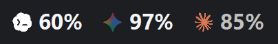

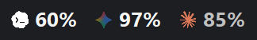

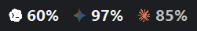

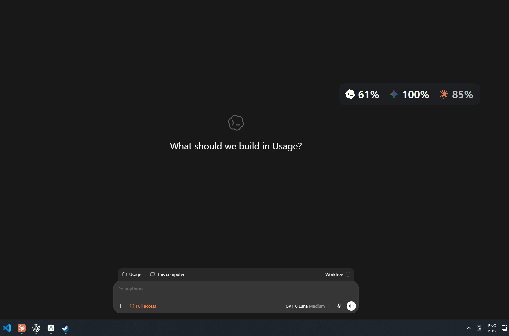

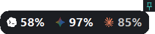

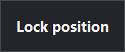

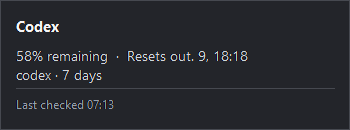

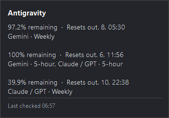

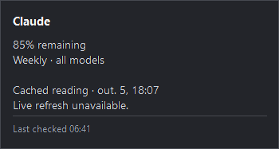

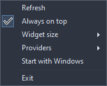

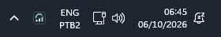

## Development and license

Build instructions and project layout: [Development](docs/DEVELOPMENT.md).

[MIT license](LICENSE). Provider logos belong to their respective owners.
[Third-party notices](THIRD-PARTY-NOTICES.md).

Unofficial project, not affiliated with OpenAI, Google or Anthropic.
